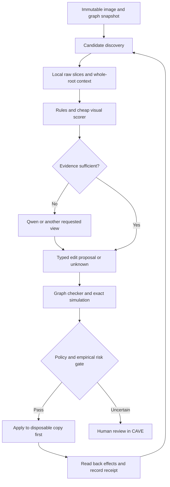

# System and morphology contracts

All architecture in this document is proposed. Source evidence and comparisons are in [01-research.md](01-research.md); actual CAVE boundaries are in [03-api.md](03-api.md).

## Objective and research hypothesis

Minimize human time and machine cost needed to reach a specified reconstruction quality, subject to a strict budget for new false merges and false splits. Optimize final tissue reconstruction, not number of edits, verbal explanation quality, or resemblance to an expert's clicks.

Research hypothesis: explicit morphology obligations plus versioned graph checks will make inexpensive visual models useful at a higher precision/coverage operating point than visual answers alone. This must be tested against the *same* candidate set and visual evidence; otherwise gains can come from a better renderer or search front end.

**Reframing:** turn proofreading into constrained search over edits and evidence. **Engineering:** stable identities, physical coordinates, replay, calibrated abstention, complete operation receipts and immutable evaluation data. Neither constitutes a biological correctness proof by itself.

## Three representations, three kinds of evidence

1. **Segmentation graph:** immutable atomic supervoxels `V`, permitted adjacency edges `E`, active edges `E_t`, and roots equal to connected components at time `t`. Spatially disconnected tissue can still have a curated identity relation; that relation must not fabricate image-supported cable through the gap. Atom refinement is a distinct operation family with explicit ancestry.
2. **Morphology graph:** skeleton/branch decomposition derived from a versioned segmentation, with width profiles, branch tangents, endpoints, soma hypotheses, compartment labels, tissue-boundary flags and uncertainty. It is a fallible measurement, not the segmentation graph itself.
3. **Biological identity/observation graph:** claims such as two anchors belonging to the same neuron, a curated separation, an axon hypothesis, or an unresolved gap. Claims retain provenance and may be disputed or superseded. The synaptic connectome is a separate graph again.

Keep three stores logically distinct, initially simple JSON/Parquet plus a transactional SQLite journal:

| Store | Examples | Authority |
|---|---|---|
| Measurements | Source hashes, raw crop bytes, segmentation snapshot, coordinate transform, skeleton extraction version | Reproducible observations of a specified representation |
| Biological claims | Continuity, membrane evidence, cell class, expert same/different identity | Empirical and defeasible; include `unknown` and conflicting claims |
| Edit certificates | Cut edges, partition conservation, seed separation, preserved constraints, affected roots | Deterministic checks relative to the recorded graph and policy |

Every claim needs `claim_id`, subject anchors, predicate, value, scope, evidence IDs, method/version and observation time. Probabilistic predictions also need score/calibration identity. Curated constraints need author, reason, validity interval and supersession history. Conflicting must-link/cannot-link claims stop the proposed edit; a model cannot silently drop one to make the checker pass.

Operational constraints in an evaluation may come only from knowledge available at its starting time or newly acquired annotations counted in its human budget. Locked final labels, NML identities and later review decisions belong to the evaluator; importing them as the checker's answers would leak ground truth. All comparison arms receive the same permitted constraints.

## The smallest useful morphology language

Start with a finite schema and a fixed checker, not arbitrary generated code. A rule has a name/version, modality/species/region/cell-type applicability, measurable predicate, required evidence, exception conditions and action (`nominate`, `request_view`, `defer`, or an operational constraint). A VLM selects candidate IDs and evidence; it cannot define the meaning of a predicate during an edit.

| Predicate or rule | Treatment | Important limit |
|---|---|---|
| Valid IDs, coordinate bounds, unit conversions, snapshot freshness | Hard representation checks | Wrong source metadata still produces wrong physical interpretation |
| Every voxel/atom retains exactly one owner after a graph edit | Hard invariant | Does not imply the owners are biologically right |
| Source and sink anchors separated after split | Hard postcondition | Does not imply the cut follows the true tissue boundary |
| Curated identity/separation constraints preserved | Hard operational policy | Curated labels can be wrong; revisions require explicit adjudication |
| Thin bottleneck, abrupt width/tangent change, close aligned endpoints | Candidate/ranking cues | Branches, spines, boutons, crossings and extraction artifacts are counterexamples |
| Multiple soma hypotheses, unexpected compartment transition | Scoped contradiction cues | Crops can contain no soma; soma detection and class predictions are uncertain |
| Neurite stops at crop boundary or missing signal | Unknown/censoring rule | Do not reward forced completion across missing tissue |
| One axon; axon originates at soma; tree-shaped neuron | Never universal axioms | Cell types, cerebellar anatomy and representations violate these simplifications |

A rule registry should grow from actual adjudicated failures. Each new rule brings one positive case, one realistic counterexample, applicability metadata and a measured contribution on held-out data. Do not declare a rule true because it matches the training annotations.

## Compositional reasoning: the actual morphology research layer

A feature registry and safe executor alone do not deliver the proposed scientific idea. Add a small typed **obligation graph**: a goal depends on claims, each claim records its premises and inference rule, and an unresolved premise becomes a specific observation request. Keep three statuses distinct: logically established from stated assumptions, empirically supported at measured reliability, and still unknown. Derived claims inherit all premise dependencies and are invalidated when any is superseded.

Worked example: two nearby axon fragments A and B might be a broken continuation or two crossing processes.

| Node | Inputs / rule | Result or outstanding obligation |
|---|---|---|
| G: propose joining A and B | Candidate contacts from the current graph | Goal is an eligible correction; biological identity is still a hypothesis |
| M1: comparable evidence | Raw crop, declared registration, coordinate/unit checker, current atom map | Exact consistency with the declared transform; physical registration still needs independent validation |
| H1/H2: continuation vs crossing | Pre-edit tangents, width, raw slices, cell-type uncertainty | Competing hypotheses; morphology favors neither as a theorem |
| O1: resolve contact ambiguity | Rule `continuation_needs_raw_path`, applicable modality/resolution and crop bounds | Request successive raw cross-sections along an enumerated path, including a view distinguishing crossing from continuity |
| E1: path supports H1 | Visual scorer/tracer output with observed scope and calibration | Empirical support; missing signal or inconsistent views keep O1 unresolved |
| P1: no protected separation violated | Versioned pre-existing constraints, complete involved components | Checked policy statement; no access to final reference identities |
| T1: union preserves purity **if** A and B are pure fragments of the same cell | Reusable conditional semantic lemma | Formal implication only; its biological premises remain empirical |
| C1: exact graph effect | Declared connecting edge, simulated union and independent checker | Proven effect on this representation |
| G disposition | M1/P1/C1 plus scoped E1 and calibrated risk policy | Eligible, request evidence, or abstain; never “identity proved from pixels” |

The same `continuation_needs_raw_path` rule can apply at many endpoints; a branch-junction variant can request evidence for a split. Cerebellar T-junctions and axons arising from dendrites are explicit exceptions to simplistic morphology contradictions. Rules may expose missing evidence or inconsistency, but do not conjure a unique anatomical answer where the image is ambiguous.

Represent every inference as `{rule_version, premise_ids, conclusion, status, scope, counterevidence_ids}` and every unresolved obligation as `{question, allowed_observation_tools, stop_condition}`. Use a bounded agenda to discharge obligations, memoize identical claims, and propagate invalidation. Do not accept arbitrary model-written inference code. The smallest experiment needs two or three such reusable rules, including a known failure case, rather than an entire ontology.

Evaluate this reasoning layer with identical observations and permitted constraints against a flat scorer/rule list. Measure damaging-decision reduction, useful abstention and reviewer effort; count how often explicit missing-premise detection changes a decision. This is the falsifiable step beyond NEURD-style features and transaction checking. Lean mechanization can later verify soundness of the conditional rules; it cannot establish their noisy biological premises.

## What the checker can establish

For an immutable atom set `V`, graph `G`, proposal `a`, and explicit operational constraints `C`, check `accept(G, C, a) → guarantees(G, apply(G,a), C)`. This is a statement about specified objects. It does **not** entail `biologically_correct(a)`.

Initial obligations:

- **Partition conservation:** a merge/split changes the atom-to-root partition, while voxel-to-atom assignment, source intensities and voxel support stay fixed. No lost, duplicated or newly fabricated atoms.
- **Merge effect:** the resulting component contains exactly the intended union; no forbidden identity pair is joined; all bridge endpoints are validated. Disallow implicit long-distance joins in the initial automatic policy.
- **Split effect:** every source anchor is separated from every sink anchor; protected pairs remain together; all removed edges are declared and cuttable. A side may consist of several components. Never assert exactly two output roots.
- **Frame property:** connectivity among vertices outside the full affected original components remains unchanged. A small spatial crop is insufficient to prove this: paths may leave the crop and re-enter.
- **Replay:** the same graph, exact edge delta and kernel version yield the same partition, compared modulo root-ID renumbering. History retains the actual assigned IDs.
- **Transaction:** preconditions are checked inside the write lock, the applied edge delta matches the certified one, and retries cannot silently duplicate an operation.

A split certificate must cover the entire relevant connectivity or an exact boundary contraction with a checked map to the full graph. “No path in this crop” is not a separation proof. Missing graph material returns `incomplete_evidence`.

Implement these first as a small deterministic Python checker over finite graphs with adversarial fixtures. It should recompute the result independently of the proposal's asserted summary. Later, formalize the graph semantics and checker soundness in Lean if this becomes a stable, valuable component. Candidate theorem names: `partition_preserved`, `cut_separates_anchors`, `merge_respects_constraints`, `unaffected_components_preserved`. No theorem has been written or compiled in this planning work. The Python/serialization/CAVE bridge remains part of the trusted implementation even if a Lean theorem is added.

## Candidate discovery and correction

Run two separate queues, and measure their recall separately:

**False-split queue (proposed action: merge).** Enumerate region-graph contacts and nearby skeleton endpoints; rank with contact evidence, physical gap, tangent compatibility, width and image continuity. Preserve a broader spatial-neighbor fallback so the initial adjacency graph does not define the recall ceiling. Distinguish contact joins from gap/identity links. Large gaps initially require human review.

**False-merge queue (proposed action: split).** Inspect suspicious junctions, constrictions, width changes, compartment inconsistencies and high-impact branch transitions. A local classifier/segmenter proposes plausible boundary regions; deterministic geometry nominates source/sink anchors on enumerated branches. Validate each anchor against the current atoms. Compute bounded alternative cuts; never let the VLM invent unchecked voxel coordinates or call mincut directly.

**October 19 correction after DW's review:** width, branch density, cell-type disagreement and unexplained endpoints are discovery hints, not sufficient error evidence. Large boutons can produce those hints together. Keep them as visible advisories; require a localized continuity/boundary question with source-image evidence before promoting a geometry-only site to an error-review recommendation. The companion consolidation policy implements the advisory distinction; a validated local bouton/error discriminator is still future work. See [the concrete policy and limitations](06-error-analysis.md).

Before diagnosing a false merge, establish that the alleged unrelated cables actually belong to the **same root at the same graph timestamp**. Render the primary root separately from contextual roots. Viewer selection, annotation groups and stored merge targets are not connected-component membership. A point must retain its coordinate frame, voxel, sampled atom/root, target atom/root, annotation ID and observation time. Background, multiple targets, a third-object source, stale roots or ambiguous coordinates create a provenance/identity question; they never silently become a join or a split. For linking, require evidence of a specific continuation and compatible identities, not merely a point's target or co-selection. Long-axon partners merit broader context, not an automatic rejection by length.

For both: deduplicate overlapping sites, estimate affected cable/identity size, retain proposal provenance and sample low-ranked sites for missed-error auditing. Recompute root-dependent candidates after every committed change. A global morphology score must not be improved by deleting legitimate branches.

## Evidence acquisition and bounded search

Default packet: raw XY/XZ/YZ slices or short adjacent-plane stacks, identical views with overlays, physical scale bars, candidate anchors, local skeleton and one wider morphology view. Preserve raw intensities; any fixed display normalization is logged alongside the raw crop. No smoothing or cosmetic repair of segmentation outputs.

Choose crop sizes in nanometers using the source transform, not an assumed “32x resolution.” Pick orientations from pre-edit geometry or image-only measurements. No final labels, post-split axes, review status, historical action text, or final-root identifiers in model inputs. Ground truth is available only to the evaluator.

When uncertain, request a larger context, higher-resolution raw slice, nearby plane, or alternate deterministic view. For the first pilot, propose at most three evidence acquisitions and two alternative edit plans per candidate; then abstain. These are engineering limits to tune on development data, not proven optima. Stop early for indivisible supervoxels or unavailable evidence.

Qwen returns a short structured decision: `merge`, `split`, `no_change`, `request_evidence`, or `abstain`; referenced candidate/anchor IDs; supporting and contradicting evidence IDs; uncertainty reason. A model confidence value is a feature, not a calibrated risk guarantee. A high-cost teacher can adjudicate a limited disagreement sample, but its labels remain model-derived unless human checked.

## Selective automation and cost

Use separate calibrators and thresholds for merges and splits, modality and relevant cell classes. Calibrate on held-out development data with naturally occurring candidate prevalence. Distribution shift or unsupported cell type routes to review. Do not multiply correlated geometry and VLM probabilities as if independent.

Prioritize approximately by `(expected error reduction × affected scientific value − expected collateral damage) / (machine cost + expected human time)`. Estimate terms empirically; retain a random audit stream so the system does not learn only from cases it already likes.

Cache crops, geometry and predictions by image hash, graph/atom generation, renderer version, coordinates, model revision and prompt version. Batch independent cases; execute overlapping edits serially. Fetching crops and remeshing may dominate latency, so record their times separately from model inference.

Longer term, use human-adjudicated local examples for specialist training or Qwen adaptation; separately record teacher-generated pseudo-labels. RL becomes worthwhile only if sequential view selection or edit planning beats bounded search at equal cost and reconstruction risk. Reward verified graph effects plus independent empirical quality, not merely rule satisfaction or a model's approval.
